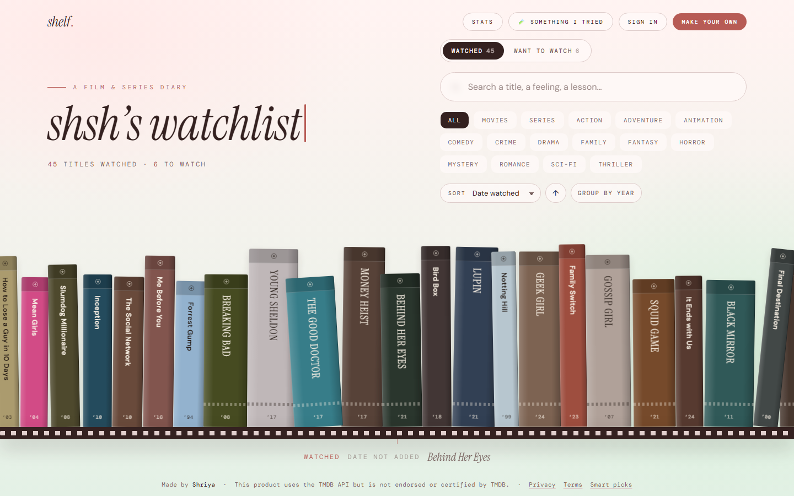
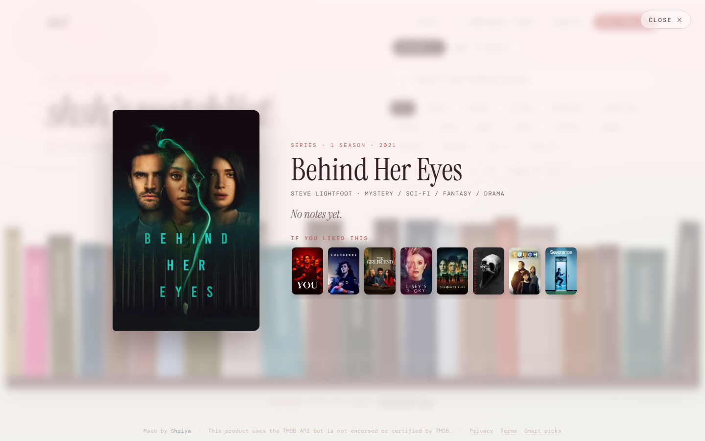
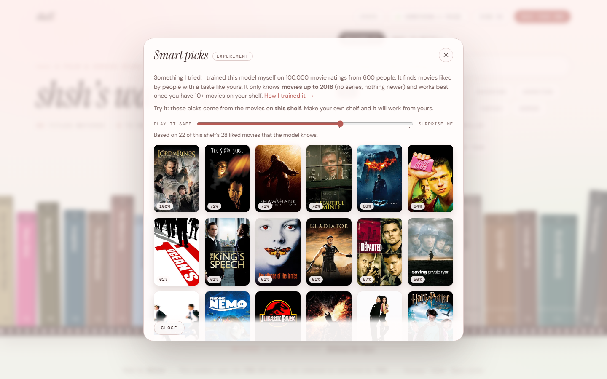

# Shelf

**Your watchlist, as a library.** Search any movie or series, add it with a click, and every title becomes a film-case spine on your own animated 3D shelf. Rate it, write what you liked and what you learned, and share your shelf with a link.

**Live:** https://shelf-shshs12.vercel.app



<table>
  <tr>
    <td width="50%"></td>
    <td width="50%"></td>
  </tr>
  <tr>
    <td align="center"><sub>Open any title: poster, notes, and more like it</sub></td>
    <td align="center"><sub>Smart picks: a recommender I trained myself</sub></td>
  </tr>
</table>

## What it does

- **Search every title.** Movies and series, with sharp posters, from TMDB. Can't find one? Add it by hand.
- **Your own shelf.** Sign up, add titles, and watch spines drop onto the shelf. Posters set each spine's colour.
- **Watched and want-to-watch lists**, with ratings, the date you watched, and "what I liked / what I learned" notes.
- **Sort, group by year, filter by genre**, plus a stats page.
- **A public page for every shelf** at `/u/username`. The home page shows the owner's shelf; anyone can look, and "Make your own" starts a new one.
- **Import a list** by pasting titles.
- **Smart picks (an experiment).** A small recommender I trained myself on MovieLens ratings. See below.

## Smart picks: a small ML experiment

I wanted to learn how recommenders work, so I trained one and plugged it into the site.

- **Data:** MovieLens "latest-small" (100,836 ratings by 610 people for 9,724 movies, ending 2018).
- **Method:** each movie gets a 128-number vector (PureSVD on the "who liked what" matrix). A person's taste is the sum of the vectors of the movies they liked, and movies are ranked by how well they line up with it. No model server and no per-user training.
- **Test:** hide each person's last liked movie and check whether it lands in the top 10. Smart picks finds it **8.6%** of the time, against **4.2%** for recommending popular movies (about 2×, 95% interval on the gain: 2.3 to 6.8 points). A PyTorch BPR model I tried did worse on data this small.
- **Limits, stated on the site:** movies up to 2018 only (no series, nothing newer), weak for people with very few movies (it falls back to popularity), and drifts toward blockbusters (a "Play it safe ↔ Surprise me" slider trades that off).

The full write-up is on the site at `/model`. The code and notebook are in [`ml/`](ml/), and `ml/parity_check.py` confirms the website's TypeScript gives the same ranking as the Python.

## Stack

Next.js 16 · React 19 · TypeScript · Framer Motion · Supabase (Postgres, auth and row-level security) · TMDB API · Vercel. The ML part is Python (scikit-learn, PyTorch, pandas).

## Run it locally

```bash
npm install
npm run dev
```

Open http://localhost:3000. With no keys the app runs in **demo mode**: your shelf is saved in your browser and search uses a small built-in catalogue.

### Turn on accounts and public pages (Supabase)

1. Create a free project at https://supabase.com.
2. **SQL Editor → New query**: paste `supabase/schema.sql` and **Run**. It creates the tables and the security rules (people can only change their own rows). Then run each `supabase/migration-00N-*.sql` file in order.
3. **Project Settings → API**: copy the Project URL and the publishable (anon) key. Never use the `service_role` key in this app.
4. In **Authentication → Sign In / Providers → Email**, "Confirm email" is switched **off**, so people can sign up and start immediately. There is no password reset. See `supabase/email-templates/` if you want to add confirmation emails later.
5. Copy `.env.example` to `.env.local` and fill it in.

### Turn on search for every title (TMDB)

Get a free key at https://www.themoviedb.org (Settings → API) and put it in `.env.local` as `TMDB_API_KEY`. It is only read on the server.

## Deploy

See [`DEPLOY.md`](DEPLOY.md): GitHub → Vercel → environment variables → Supabase Site URL.

## Where things are

| Path | What it does |
| --- | --- |
| `src/components/LibraryView.tsx` | The page: heading, filters, shelf, modals |
| `src/components/Shelf.tsx` | The 3D shelf: drop-in animation, momentum scrolling, hover card |
| `src/components/AddModal.tsx` | Live search, add by hand, then rating, date and notes |
| `src/components/SmartPicksModal.tsx` | The Smart picks experiment |
| `src/app/model/page.tsx` | The "how I trained it" page |
| `src/lib/smartpicks.ts` | Ranking from the exported model |
| `src/app/api/*` | Server routes (TMDB search, titles, recommendations, Smart picks) |
| `data/smartpicks/` | The model's exported numbers (read by the server) |
| `ml/` | Training code, notebook, charts and export scripts |
| `supabase/` | Database schema, migrations and email templates |

## Credits

- Movie and series data and posters: this product uses the TMDB API but is not endorsed or certified by TMDB.
- Training data: F. Maxwell Harper and Joseph A. Konstan, *The MovieLens Datasets: History and Context*, ACM TiiS 5(4), 2015 (GroupLens, University of Minnesota; non-commercial research and education use).

Made by Shriya.
